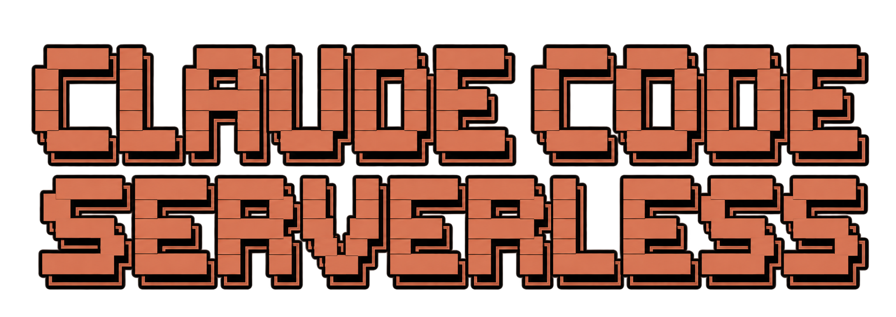

<p align="center">
  
</p>

<p align="center">
  <a href="https://github.com/Alejo2075/claude-code-aws/actions/workflows/ci.yml"></a>
  <a href="https://github.com/Alejo2075/claude-code-aws/actions/workflows/codeql.yml"></a>
  <a href="#plugin-catalog"></a>
  <a href=".claude-plugin/marketplace.json"></a>
  <a href="#plugin-catalog"></a>
  <a href="package.json"></a>
  <a href="docs/install.md"></a>
  <a href="pnpm-workspace.yaml"></a>
  <a href="LICENSE"></a>
  <a href="CONTRIBUTING.md"></a>
</p>

<p align="center"><strong>Open-source Claude Code plugins for serverless development on AWS.</strong></p>

This project extends Claude Code with focused capabilities for designing, building, testing, deploying, and operating AWS serverless applications. Install the plugins that fit your workflow and keep using your existing AWS accounts, credentials, and tools.

Infrastructure analysis currently focuses on AWS CDK with TypeScript and CloudFormation. The project is developed in the open: capabilities appear in the repository before they are necessarily ready for marketplace installation.

## Plugin catalog

The catalog below describes the plugins currently in this repository. Each plugin is developed as a separate capability, so you can install only what your workflow needs.

### 1. Core & Experience · 4 plugins

Account context, Claude Code interface, safety guardrails, and AWS resource exploration.

| Plugin                                                | What it helps with                                           |
| ----------------------------------------------------- | ------------------------------------------------------------ |
| [aws-context](plugins/core-experience/aws-context/)   | AWS accounts, profiles, regions, and verified credentials.   |
| [aws-ui](plugins/core-experience/aws-ui/)             | Claude Code interface, prompt footer, mods, and visualizers. |
| [aws-guard](plugins/core-experience/aws-guard/)       | Approval prompts for potentially dangerous AWS operations.   |
| [aws-explorer](plugins/core-experience/aws-explorer/) | Read-only exploration of AWS resources and stack state.      |

### 2. Design · 5 plugins

Architecture, infrastructure design, diagrams, prototypes, and AWS best-practice reviews.

| Plugin                                                       | What it helps with                                             |
| ------------------------------------------------------------ | -------------------------------------------------------------- |
| [aws-architect](plugins/design/aws-architect/)               | Architecture design, technical decisions, reviews, and ADRs.   |
| [aws-infrastructure](plugins/design/aws-infrastructure/)     | Serverless infrastructure development with CDK and TypeScript. |
| [aws-diagrams](plugins/design/aws-diagrams/)                 | Architecture, resource, and event-flow diagrams.               |
| [aws-prototyping](plugins/design/aws-prototyping/)           | Functional prototypes and bounded proof-of-concepts.           |
| [aws-well-architected](plugins/design/aws-well-architected/) | Reviews across the six AWS Well-Architected pillars.           |

### 3. Development · 14 plugins

Service-focused plugins for building serverless application components.

| Subcategory   | Plugin                                                            | Services                                             |
| ------------- | ----------------------------------------------------------------- | ---------------------------------------------------- |
| Compute       | [aws-lambda](plugins/development/compute/aws-lambda/)             | AWS Lambda                                           |
| Compute       | [aws-containers](plugins/development/compute/aws-containers/)     | ECS, Fargate, ECR                                    |
| APIs          | [aws-api](plugins/development/apis/aws-api/)                      | API Gateway; AppSync support is a planned extension. |
| Identity      | [aws-auth](plugins/development/identity/aws-auth/)                | Amazon Cognito                                       |
| Events        | [aws-events](plugins/development/events/aws-events/)              | EventBridge, Scheduler                               |
| Messaging     | [aws-messaging](plugins/development/messaging/aws-messaging/)     | SQS, SNS                                             |
| Orchestration | [aws-workflows](plugins/development/orchestration/aws-workflows/) | Step Functions                                       |
| Streaming     | [aws-streaming](plugins/development/streaming/aws-streaming/)     | Kinesis Data Streams, Data Firehose                  |
| Databases     | [aws-database](plugins/development/databases/aws-database/)       | DynamoDB, Aurora Serverless                          |
| Storage       | [aws-storage](plugins/development/storage/aws-storage/)           | S3, EFS                                              |
| Edge          | [aws-edge](plugins/development/edge/aws-edge/)                    | CloudFront, Lambda@Edge                              |
| AI            | [aws-ai](plugins/development/ai/aws-ai/)                          | Amazon Bedrock; AgentCore coverage is planned.       |
| Communication | [aws-email](plugins/development/communication/aws-email/)         | Amazon SES                                           |
| Configuration | [aws-config](plugins/development/configuration/aws-config/)       | AppConfig, Parameter Store                           |

### 4. Quality & Operations · 5 plugins

Security, testing, delivery, cost, and production operations.

| Plugin                                                             | What it helps with                                         |
| ------------------------------------------------------------------ | ---------------------------------------------------------- |
| [aws-security](plugins/quality-operations/aws-security/)           | IAM, security audits, and protection reviews.              |
| [aws-testing](plugins/quality-operations/aws-testing/)             | Unit and integration tests and validation workflows.       |
| [aws-deploy](plugins/quality-operations/aws-deploy/)               | CDK deployments, pipelines, and recovery workflows.        |
| [aws-cost](plugins/quality-operations/aws-cost/)                   | Cost estimates and optimization analysis.                  |
| [aws-observability](plugins/quality-operations/aws-observability/) | Logs, metrics, traces, alarms, and incident investigation. |

## Availability

There are 28 plugins in the repository. The marketplace currently publishes **[aws-context](plugins/core-experience/aws-context/) and [aws-ui](plugins/core-experience/aws-ui/)**. The other plugins are under development and validation; their presence in the catalog does not mean they are ready to install.

Add the marketplace and install the published plugins from a Claude Code session:

```text
/plugin marketplace add Alejo2075/claude-code-aws
/plugin install aws-context@claude-code-aws
/plugin install aws-ui@claude-code-aws
```

See the [development guide](docs/development.md) for prerequisites and the [security model](docs/security.md) for credential handling and operation limits.

## Safety and privacy

- Plugins use your existing AWS credentials; the project does not provide a hosted control plane or telemetry service.
- Inspection, planning, and review are read-only by default. Cloud changes require clear plans and explicit authorization.
- Findings distinguish verified AWS state from local definitions, estimates, inferences, and unknowns.
- Local checks have limited coverage. Use IAM, permission boundaries, and AWS Organizations policies as enforcement controls.

## Develop locally

This is a pnpm and TypeScript monorepo. Use Node.js 22.12 or later and pnpm 10.34.8.

```sh
corepack enable
pnpm install
pnpm verify
```

`pnpm verify` runs formatting, lint, type checking, plugin builds, tests, marketplace validation, packaging, and release-flow checks. To scaffold a plugin, run `pnpm new:plugin <name> "<short description>"`. See [CONTRIBUTING.md](CONTRIBUTING.md), the [development guide](docs/development.md), and the [release guide](docs/release.md).

## Project documentation

- [Architecture](docs/architecture.md)
- [Development](docs/development.md)
- [Security](docs/security.md)
- [Releases](docs/release.md)

The project is licensed under [MIT](LICENSE). Product and engineering requirements are maintained in [CLAUDE.md](CLAUDE.md).
